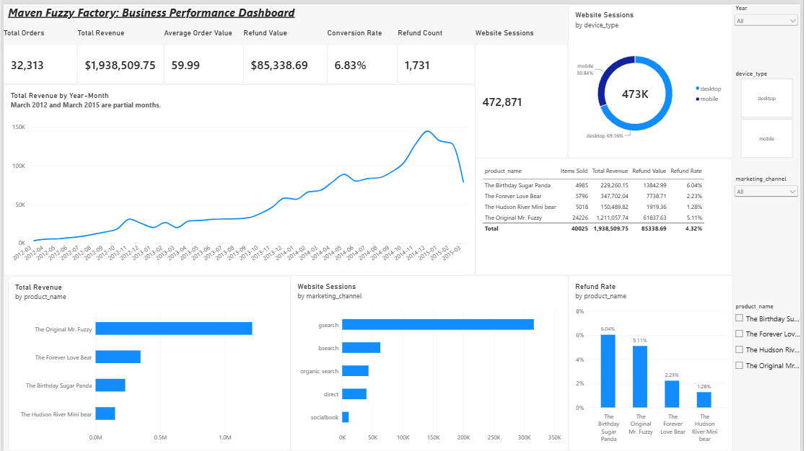

# Maven Fuzzy Factory: E-commerce Sales Performance and Customer Behaviour Analysis

AnalystLab Africa Experience Lab | Week 2 | Track 1: Data Analytics

## Business Problem
Maven Fuzzy Factory is an e-commerce company that wants to understand how its website performs, which marketing channels drive sales, which products perform best, and how refunds affect revenue. This project analyses the company's data to find performance gaps and recommend improvements.

## Objectives
- Clean and prepare six datasets and map the relationships between them
- Answer 10 business questions with SQL
- Build an interactive Power BI dashboard
- Deliver 5 to 7 business insights with recommendations

## Tools
Python (pandas), PostgreSQL, Power BI, Git and GitHub

## Datasets
| File | Description |
|---|---|
| website_sessions.csv | Website visits, with source, device and campaign |
| website_pageviews.csv | Pages viewed in each session |
| orders_mav.csv | Customer orders |
| order_items.csv | Products within each order |
| order_item_refunds.csv | Refunded items |
| products.csv | Product details |

## Data Model

| Table | Primary Key | Foreign Keys |
|---|---|---|
| website_sessions | website_session_id | none |
| website_pageviews | website_pageview_id | website_session_id -> website_sessions |
| orders_mav | order_id | website_session_id -> website_sessions; primary_product_id -> products |
| order_items | order_item_id | order_id -> orders_mav; product_id -> products |
| order_item_refunds | order_item_refund_id | order_item_id -> order_items; order_id -> orders_mav |
| products | product_id | none |

Relationships: one session has many pageviews; one session has at most one order; one order has many order items; one order item has at most one refund.

**Data limitation:** website_pageviews.csv contains 1,048,575 data rows (the Excel row limit of 1,048,576 including the header), so it is likely truncated. It is not used for the 10 SQL questions.

## Data Preparation
- Checked all six tables for missing values, duplicates, data types and broken keys (notebooks/01_data_quality_check.ipynb).
- No duplicate rows or duplicate IDs in any table.
- Only website_sessions had missing values. The UTM columns (83,328 rows) are blank for visits that did not come from a paid ad, and http_referer is blank for 39,917 visits.
- Converted all created_at columns from text to datetime.
- Created marketing_channel: the UTM source if present; otherwise organic_search if a referer exists (43,411 sessions), otherwise direct (39,917 sessions). No rows were deleted.
- Cleaned files are in data/processed/ (notebooks/02_data_cleaning.ipynb).

## SQL Analysis
Scripts: `sql/01_create_tables.sql` (schema) and `sql/02_business_queries.sql` (14 queries, PostgreSQL).

| Question | Result |
|---|---|
| Unique orders | 32,313 |
| Total revenue | $1,938,509.75 |
| Average order value | $59.99 |
| Top product | The Original Mr. Fuzzy ($1,211,057.74, 62.5% of revenue) |
| Top channel by sessions | gsearch (316,035 sessions, 66.8%) |
| Top device by sessions | Desktop (327,027 sessions, 69.2%) |
| Session-to-order conversion | 6.83% |
| Refunds | 1,731 refunds worth $85,338.69 |
| Highest revenue month (complete months) | December 2014: $144,823.02 (2,314 orders) |
| Lowest revenue month (complete months) | April 2012: $4,949.01 (99 orders) |

Note: the company sells only four products, so the "top five products" query returns four rows. The data has no product category column, so product performance is compared by individual product (revenue, profit and margin). March 2012 and March 2015 are partial months, so month rankings use complete months only.

## Dashboard

Power BI file: `powerbi/maven_fuzzy_factory_dashboard.pbix` (KPIs, revenue by month, top products, sessions by channel and device, refund analysis, slicers for year, device, channel and product).

## Key Insights and Recommendations
1. **One product carries the business.** The Original Mr. Fuzzy is 62.5% of revenue. Newer products have higher margins (68% vs 61%). Promote them through bundles.
2. **Mobile converts far below desktop.** 3.09% vs 8.50% on 30.8% of traffic. Audit the mobile checkout and page speed.
3. **Heavy reliance on Google paid search.** gsearch is 66.8% of sessions and converts at 6.75%, below organic and bsearch. Diversify channels.
4. **Socialbook underperforms.** 3.21% conversion and 343 orders. Review or retarget the spend.
5. **Refunds are concentrated.** 1,731 refunds ($85,338.69). Sugar Panda (6.04%) and Mr. Fuzzy (5.11%) are highest. Investigate quality and descriptions.
6. **Repeat visitors convert better.** 7.83% vs 6.64% for new visitors. Invest in email and retargeting.
7. **Strong growth with a Q4 2014 peak.** Revenue grew from $4,949 (Apr 2012) to $144,823 (Dec 2014). Only two full Decembers exist, so seasonality is suggestive.

## Limitations
- website_pageviews.csv is truncated at the Excel row limit (data ends January 2015), so it was not used.
- March 2012 and March 2015 are partial months; month rankings use complete months.
- The data has no product category column, so products were compared individually.